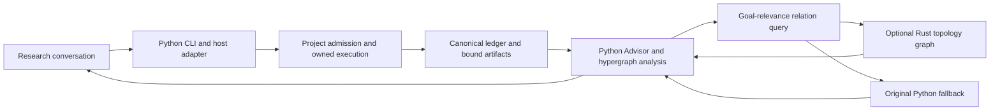

# Optional native relations and event transport

The native backend supplies bounded relation queries and a volatile event queue.
Python retains admission, ledger transactions, receipts, budgets, Advisor policy
and CLI routing. A relation query is a derived view and grants no execution or
scientific assurance. The existing owned process launcher remains responsible
for Windows worker ownership.



`scripts/rds_bus_adapter.py` loads the C ABI 2 library from `native/rds_bus`.
Local native libraries are trusted executable code. ABI checks establish
interface compatibility, not authenticity or a sandbox. Graph operations include
backward dependencies, forward AND/OR closure, an unresolved prerequisite
frontier and clearing a derived view. The frontier is not a minimum cut.
Analogy and obstruction edges do not establish deductions. A graph's truth
labels are supplied inputs to a calculation; callers must retain original
evidence and its assurance in the ledger.

`rds_hypergraph._goal_relevance` is the first existing caller using the relation
backend. It projects non-contradicted dependency edges, preserves the original
result sets and closes the graph after the query. The existing supported-closure,
receipt-grounding and certificate checks retain their own semantics. Other
Advisor/state paths have not all moved to Rust.

Native mode retains graph state in Rust rather than duplicating all nodes and
edges in Python. Item limits and byte-accounting limits bound admitted graph
size and queue payloads; allocator overhead, transient copies and caller-owned
buffers remain additional memory. These limits are not an OS-enforced RSS cap.
The Python fallback is independently bounded and may have larger object overhead.

The graph admits at most 4,096 nodes, 16,384 edges and an 8 MiB accounting
budget. The queue admits at most 4,096 events, 1 MiB per payload and 64 MiB
of queued payload. Smaller limits can be selected by trusted callers. Full
queues reject the next event without dropping an older event or consuming the
caller's input. Close the view/queue at the end of its lifetime.

`EventBus` is an in-process FIFO with a native and Python implementation.
It is not a cross-process service or durable outbox. Closing the process loses
queued events. Training-completion delivery still needs committed evidence,
durable publication, acknowledgements and an actual host wakeup adapter.
The Rust Job Object exports are guard scaffolding and are not an alternative
admitted execution route.

Build and check the optional library from a checkout:

```text
cargo test --offline --manifest-path native/rds_bus/Cargo.toml
cargo build --offline --release --manifest-path native/rds_bus/Cargo.toml
python -B -m unittest discover -s tests -p 'test_rds_bus*.py' -v
```

The native CI jobs build the shared library and set `RDS_REQUIRE_BUS=1` while
checking compiled adapter and caller parity. Missing required native code must
produce a failed check rather than a native-test availability skip. Normal
installations can retain the supported Python path when the optional library
is unavailable. macOS library naming is recognized; this does not establish
live macOS acceptance.

## Existing data

Transport ABI and stored data format are separate contracts. This relation
backend does not rewrite project ledgers, migrate reference state or replace
evidence. Historical data keeps its stored version, receipt identities and
spent/reserved resources. The [versioning contract](versioning.md) specifies
the explicitly supported reference versions. Read compatibility does not
permit execution with mismatched engine bindings or accept an old certificate
without its required replay.

A changed database schema needs its own inspected conversion route, consistent
backup, side-by-side validation and safe handoff of pending work. Do not edit
version or engine hashes to bypass admission, create a replacement ledger to
reset costs, or restore an older snapshot over newer committed progress.
No general-purpose migration command is introduced by the native transport.
