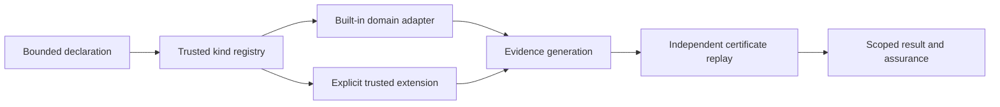

# Trusted verifier routing

RDS routes built-in and explicitly registered extension statement kinds through
one registry. Registration selects a checker; it does not establish a theorem,
authorize an experiment or grant ledger access.



## Component boundaries

- `scripts/rds_verify_registry.py` contains the registration contract and route
  lookup. It imports only the standard library and `rds_core`, not a domain
  verifier, CLI or project store.
- `scripts/rds_builtin_verifiers.py` adapts existing domain generation,
  normalization and replay, and the checked-premise `logic.and_intro` rule.
- `scripts/rds_verify.py` is the composition root. It installs the explicit
  built-in inventory, resolves routes and retains the existing proof envelopes.
- Existing domain modules retain their mathematical checks and resource
  semantics. Native Lean evidence still requires actual native checking;
  registration itself never supplies `LEAN_KERNEL_CHECKED`.

`ProofRule` and `RuleRegistry` remain compatibility declaration/query APIs.
Adding a declaration to that legacy table does not install a route or bypass
the registry. Route descriptions distinguish `builtin`, `registered` and
`uninstalled` entries.

## Extension contract

Reviewed Python code implements `VerifierSpec` with a bounded name, owned kinds,
semantics, assurance category and version, plus `read_spec`, `verify` and
`check_certificate`. Registration is explicit; JSON input cannot register code,
and there is no automatic search for arbitrary plugin modules.

Extension names and kinds cannot collide with built-in routes, including
conjunction. Ordinary extension registration cannot declare reserved built-in
assurances or unregister a built-in checker. Extension evidence must match its
declared nonreserved assurance. Replay checks a copy and rejects evidence
relabelled by the checker; a successful callback cannot turn extension evidence
into native kernel evidence.

These checks are API boundaries, not a Python sandbox. An imported plugin is
trusted executable code and can have process privileges. Untrusted plugins need
a separately admitted, isolated execution design; this registry does not provide
one. A plugin's mathematical semantics and checker still require review.

## Identity and compatibility

Verifier identity binds effective routes, built-in provenance and implementation
mapping, checker/adapter source bytes, declared built-in support files and the
Python runtime. An extension's defining module is fingerprinted; its imported
helpers, compiled libraries and external data do not receive an automatic
transitive dependency binding. Review those dependencies separately; do not
assume their replacement invalidates an old certificate's verifier identity.
Preserve
existing public rule names, normalization, explicit work budgets and independent
replay when changing an adapter. Extensions that do not support an explicit work
budget must reject that request rather than silently ignore it.

A certificate from an earlier implementation remains historical evidence. The
current checker rejects a mismatched verifier identity; do not rewrite the old
certificate or alter its stored hash to make it pass. Current acceptance needs
fresh generation or the explicitly supported replay path. This does not reset
project spending or migrate a ledger.

Native availability and scientific scope remain separate. Missing Lean or
unbuilt statistical libraries cannot mint new kernel-checked results. Exact
rational fallback, where permitted, has its own lower assurance. A conditional
theorem does not prove that its assumptions hold for an experiment.

## Regression checks

Run the registration and public routing tests when changing this boundary:

```text
python -B -m unittest discover -s tests -p 'test_rds_verify*.py' -v
python -B -m unittest discover -s tests -p test_rds_builtin_verifiers.py -v
```

Keep collision-before-import, multikind ownership, source-identity drift,
normalization, explicit-budget, forged-assurance, checker-mutation and historical
certificate cases. Domain, native-runtime, packaging and release checks remain
separate obligations; these focused suites do not establish release readiness
or scientific benefit.
